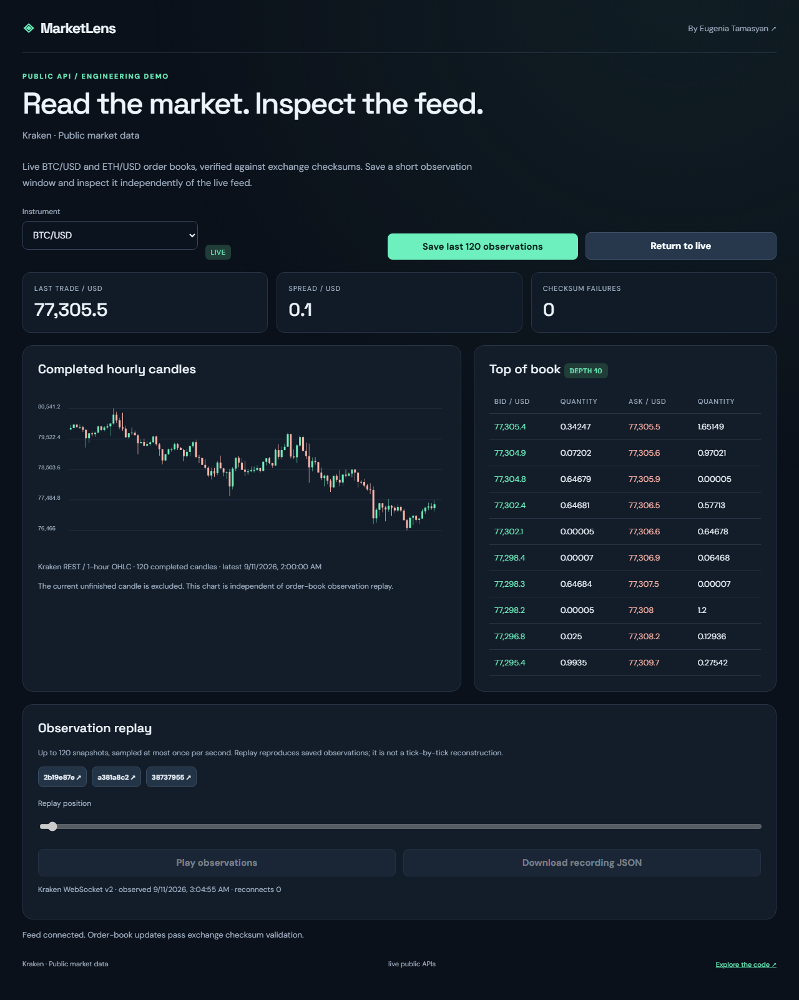
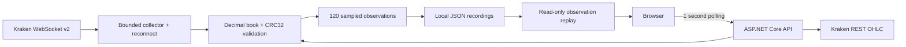

# MarketLens

[](https://github.com/itinessity/market-lens/actions/workflows/ci.yml)


A real exchange-data workstation for BTC/USD and ETH/USD: live order books, completed hourly candles and saved observation replay.

**[Eugenia Tamasyan](https://itinessity.com)** · Senior .NET Backend Engineer · FinTech & Distributed Systems



## What you can try

- One unauthenticated Kraken WebSocket v2 connection, with book and ticker subscriptions for two instruments.
- A depth-ten order book using decimal arithmetic, quantity-zero deletion and Kraken CRC32 checksum verification.
- On a mismatch or disconnect, discard the current book, reconnect with bounded backoff and subscribe for fresh snapshots.
- Feed states for connecting, live, stale and reconnecting; observation timestamps, reconnect count and checksum failures.
- Up to 120 completed hourly candles from Kraken REST, explicitly excluding the current unfinished candle.
- A bounded history of 120 observations sampled at most once per second, persistent JSON recordings and an independent replay slider/player.

## Run locally

Requires the **.NET 10 SDK**. No provider account or API key is needed. Internet access is required for live data.

```bash
dotnet run --project src/App.csproj -c Release
```

Open **http://127.0.0.1:8080**. The application binds to loopback by default. To run several demos simultaneously, set a different `ASPNETCORE_URLS` per process. Each repository is independent.

Or use Docker:

```bash
docker compose up --build
```

The container also exposes only local port 8080 through Compose. It runs as the .NET image's non-root `app` user. Stop it with `docker compose down`; the named data volume persists.

Saved JSON lives under `DATA_DIR` (default `.data` relative to the process working directory). Writes use a temporary file and atomic rename in a single process. The store caps records at 200 and lists the 30 most recent in the UI. Export and remove old local records when capacity is reached. Do not share this directory between multiple application processes.

## Walkthrough

1. Open the app and wait for the feed to report **LIVE**. Select BTC/USD or ETH/USD.
2. Inspect the spread, depth and completed candles; the timestamp identifies the latest feed observation.
3. Save the recent observations, then select the saved recording.
4. Move the replay slider or play the observations. Replay is clearly labeled; the live collector continues independently.
5. Return to live or download the saved recording as JSON.

## Architecture



The backend uses ASP.NET Core minimal APIs and built-in .NET libraries. The browser uses plain JavaScript and CSS; Node.js is needed only for browser tests. Provider/domain logic is separated from the HTTP endpoints in `src/`. The common infrastructure is intentionally small enough to inspect.

## API

| Endpoint | Behavior |
|---|---|
| `GET /api/market` | Current feed state and two instrument snapshots |
| `GET /api/candles?symbol=BTC%2FUSD` | Most recent 120 completed hourly candles |
| `POST /api/recordings` | Freeze the current bounded observation history |
| `GET /api/recordings` | Up to 30 recent recording IDs |
| `GET /api/recordings/{id}` | Immutable saved observations |
| `GET /api/health` | Process status and an explicit live/fixture mode label |

The API accepts JSON request bodies and returns structured errors. Bodies are limited to 64 KB. Browser writes with a foreign Origin are rejected. The health endpoint reports process availability, not guaranteed provider availability.

## Verify

```bash
dotnet build src/App.csproj -c Release
dotnet run --project tests/Tests.csproj -c Release
python tests/integration.py
npm ci
npx playwright install chromium
npm run test:browser
```

Official Kraken CRC32 reference vector (3310070434), side ordering, zero-quantity deletion, depth bounds, checksum rejection, fresh-snapshot recovery and saved replay equivalence. Browser tests cover live/record/replay transitions using explicit fixtures.

The C# checks are dependency-free executable assertions. HTTP tests launch an isolated process with a temporary data directory. Playwright covers the primary user flow and mobile overflow. CI runs all three layers on Ubuntu, builds a Release publish output and uses deterministic fixtures, so it does not depend on public-provider uptime.

Fixtures require **both** `ASPNETCORE_ENVIRONMENT=Testing` and `TestFixtures=true`. The UI labels fixture mode. Real-provider outages are never replaced by fixture data. Local live-provider and visual smoke checks are documented in [verification notes](docs/VERIFICATION.md).

## Boundaries and trade-offs

Replay reproduces normalized sampled observations, not every trade or raw protocol message. The candle chart is an independent REST view and does not rewind with order-book replay. A recording can contain fewer than 120 samples after startup. The UI polls the local server once per second; it does not open an upstream exchange connection per browser.

The status becomes stale if the last socket message is older than 15 seconds. A 20-second receive timeout triggers reconnection; backoff grows to at most 30 seconds. Reconnect and checksum counters are process-lifetime diagnostics. No latency SLA is implied.

Kraken's OHLC endpoint offers at most 720 recent entries, including the current unfinished candle. This demo displays only the latest 120 completed entries, and has no arbitrary historical backtest feature. Public exchange observations are not necessarily public-domain data; provider terms still apply. There are no account, order-placement or trading-credential endpoints.

This is a runnable local reference implementation, not a publicly hosted production service. Before deploying it for shared use, address the controls listed in [SECURITY.md](SECURITY.md). Original code is MIT-licensed; external data and vendored assets retain their own terms.

## Data sources

- [Kraken book checksum guide](https://docs.kraken.com/exchange/guides/websockets/book-checksum-v2)
- [Kraken OHLC endpoint](https://docs.kraken.com/api-reference/market-data/get-ohlc-data)
- [Kraken public WebSocket access](https://support.kraken.com/articles/360022326871-kraken-websocket-api-frequently-asked-questions)

## About the author

I build .NET backends, trading integrations and reliable data workflows. See [itinessity.com](https://itinessity.com) for commercial experience and ways to work together.
